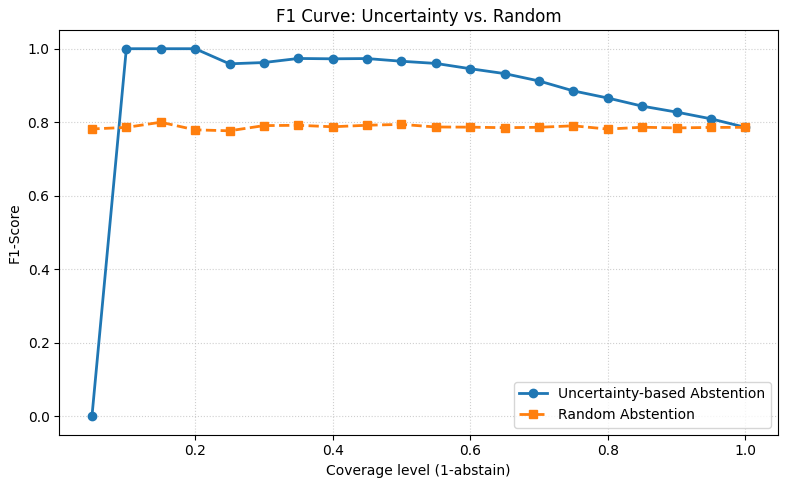

# markov-blanket-bnn-insurance

**Markov blanket feature selection with Bayesian neural networks for motor insurance claim prediction: an actuarial benchmark.**

This repository accompanies the paper *Markov Blanket Feature Selection with Bayesian Neural Networks for Motor Insurance Claim Prediction: An Actuarial Benchmark* (Khan & Megrez, 2026), prepared for the *Annals of Actuarial Science* (Cambridge University Press).

It compares a GLM, XGBoost and a Bayesian neural network (BNN), each trained with and without Markov blanket feature selection, on a real Spanish motor insurance portfolio. The focus is on predictive performance, epistemic uncertainty, and uncertainty-guided abstention.

---

## Highlights

- Predictive Permutation Feature Selection (PPFS) cut the feature space from **41 to 12** (70.73% reduction), with performance maintained or marginally improved for all three models.
- GLM, XGBoost and BNN, each with and without Markov blanket selection, on one fixed stratified split.
- Results showed XGBoost-MB achieved the best overall performance (AUC-ROC 0.9634, F1 0.7925), with BNN-MB close behind (AUC-ROC 0.9599, F1 0.7861). The BNN-MB improved on the full-feature BNN in both AUC-ROC and F1 while using 12 rather than 41 features.
- Ranking BNN-MB test predictions by epistemic variance and abstaining on the most uncertain cases raises F1 to about 0.94 at 60% coverage(peak about 20% coverage), versus a flat 0.77-0.80 under random abstention at matched coverage.

---

## Repository structure

```

markov-blanket-bnn-insurance/
├── README.md
├── LICENSE
├── .gitignore
├── requirements.txt
├── motor-insurance-claim-prediction.ipynb
└── figures/
    ├── bnn_elbo.png
    ├── mbnn_elbo.png
    └── curve5.png
```

---

## Data

The study uses the publicly available motor vehicle insurance portfolio of Lledó and Pavía (2024), described in Segura-Gisbert et al. (2025).

- **Source:** Mendeley Data, <https://doi.org/10.17632/5cxyb5fp4f.2>
- **Coverage:** 2015-2018, 105,555 policyholder-year records, 30 features (policy details, vehicle attributes, telematics, driver licence information)
- **Target:** `Claim Occurred` = 1 if at least one claim was filed in the policy year, else 0

The dataset is not redistributed here. Download it from the link above and place the files in `data/raw/`.

**Preprocessing summary**

- Claim cost and claim count variables removed to prevent leakage
- `Date_lapse` dropped (structurally missing for active policies); rows with missing `Length` or `Type_fuel` removed
- Five engineered features: policyholder age, age at licence, driving experience, `Early_license` flag, vehicle age
- `Length`, `Power` and `Value_vehicle` discretised into quantile bins; remaining categoricals one-hot encoded
- Final dataset: **95,226 observations, 41 features**, claim rate 19.7%
- Stratified 70/15/15 train/validation/test split, fixed before all modelling and shared by all six models
- SMOTE applied to the training partition only

---

## Methodology

### 1. Markov blanket discovery (PPFS)

PPFS (Hassan et al., 2025) is run via the `PPIMBC` implementation in the **PyImpetus** library, on the training partition before SMOTE.

| Setting | Value |
|---|---|
| Significance level | 0.05 |
| K-folds | 3 |
| Bootstrap simulations per test | 15 |
| Base learner | XGBoost (logistic, 40 trees, depth 4, learning rate 0.1) |

**Retained features (12):** `Seniority`, `Policies_in_force`, `Lapse`, `Premium`, `N_claims_history`, `R_claims_history`, `Year_matriculation`, `Vehicle_Age`, `Payment_1`, `Driving_experience`, `Max_policies`, `Distribution_channel_1`.

### 2. Models

A 3 x 2 crossed design: {GLM, XGBoost, BNN} x {all 41 features, 12-feature Markov blanket}. Hyperparameters and the decision threshold (searched over 0.50-0.85 in steps of 0.05) are tuned jointly on the validation set by maximising F1.

| Model | Details | Search grid |
|---|---|---|
| GLM | Logistic regression, L-BFGS (scikit-learn) | C in {0.01, 0.1, 1, 10} |
| XGBoost | Binary logistic objective | learning rate {0.1, 0.01, 0.001}, depth {3, 5, 7}, estimators {100, 200, 300} |
| BNN | 2 hidden layers (30, 15), tanh, sigmoid output, Gaussian weight prior, PyMC with ADVI (Adam, 40,000 iterations) | learning rate {0.001, 0.01}, prior std {0.5, 1.0} |

### 3. BNN uncertainty

Predictions use 15,000 posterior weight samples. The posterior predictive mean is the average of the sigmoid outputs, and the **epistemic uncertainty** is their variance, following the variance decomposition of Kendall & Gal (2017) and the formulation of Kwon et al. (2020).

### 4. Risk-coverage analysis

Test observations are ranked by epistemic variance and abstained from in order of decreasing uncertainty. F1 is recomputed at each coverage level and compared with random abstention at matched coverage (selective classification, Geifman & El-Yaniv, 2017).

---

## Results

All reported results are based on a single run using fixed random seeds.
Small numerical differences may arise across software versions and hardware.

### Performance on the test set


| Model | Features | Accuracy | F1 | Precision | Recall | AUC-ROC | Brier |
|---|---:|---:|---:|---:|---:|---:|---:|
| GLM | 41 | 0.8878 | 0.7377 | 0.6850 | 0.7992 | 0.9331 | 0.0984 |
| XGBoost | 41 | 0.9170 | 0.7867 | 0.7979 | 0.7758 | 0.9625 | 0.0607 |
| BNN | 41 | 0.9046 | 0.7707 | 0.7329 | 0.8127 | 0.9550 | 0.0828 |
| GLM-MB | 12 | 0.8880 | 0.7384 | 0.6849 | 0.8010 | 0.9342 | 0.1003 |
| XGBoost-MB | 12 | 0.9166 | 0.7925 | 0.7786 | 0.8070 | 0.9634 | 0.0608 |
| BNN-MB | 12 | 0.9119 | 0.7861 | 0.7542 | 0.8209 | 0.9599 | 0.0793 |


### Training time

| Model | Without MB (s) | With MB (s) | Reduction |
|---|---|---|---|
| GLM | 0.80 | 0.36 | 55.00% |
| XGBoost | 5.25 | 1.25 | 76.19% |
| BNN | 106.12 | 98.75 | 6.94% |

### Risk-coverage curve (BNN-MB)



Uncertainty-guided abstention beats random abstention across almost the whole coverage range. The trade-off is lower coverage: fewer policyholders receive an automated prediction.


## Getting started

```bash
git clone https://github.com/umairk13/markov-blanket-bnn-insurance.git
cd markov-blanket-bnn-insurance

python -m venv .venv
source .venv/bin/activate        # Windows: .venv\Scripts\activate
pip install -r requirements.txt
```

Main dependencies: `numpy`, `pandas`, `scikit-learn`, `imbalanced-learn` (SMOTE), `xgboost`, `pymc`, `pyimpetus`, `scipy`, `matplotlib`, `jupyter`.

Then download the dataset into `data/raw/` and run the notebooks in order (`01` to `05`).


## Limitations

- The Markov blanket is learned on a 'single Spanish portfolio', so the 12-feature set should be read as portfolio-specific, a benchmark for external validation rather than a universal signature.
- PPFS uses XGBoost as its internal base learner, so the selected subset may partly reflect that learner.
- A stratified random split is used, not a temporal one, so year-on-year stability is not measured.
- Results depend on the observed claim rate (19.7%); a much lower rate could affect the stability of the conditional-independence assessment.

Future work: validation on other markets, temporal backtesting, extension to claim severity, and a calibrated abstention threshold for a full selective-prediction triage system.


## Authors

- **Umair Mohammed Khan** (<khan.umair1303@gmail.com>), School of Mathematical and Computer Sciences, Heriot-Watt University Dubai
- **Nasreddine Megrez** (<n.megrez@hw.ac.uk>), School of Mathematical and Computer Sciences, Heriot-Watt University Dubai


## Acknowledgements

Dataset by Lledó and Pavía (2024). PPFS by Hassan et al. (2025). Bayesian modelling with [PyMC](https://www.pymc.io/).
